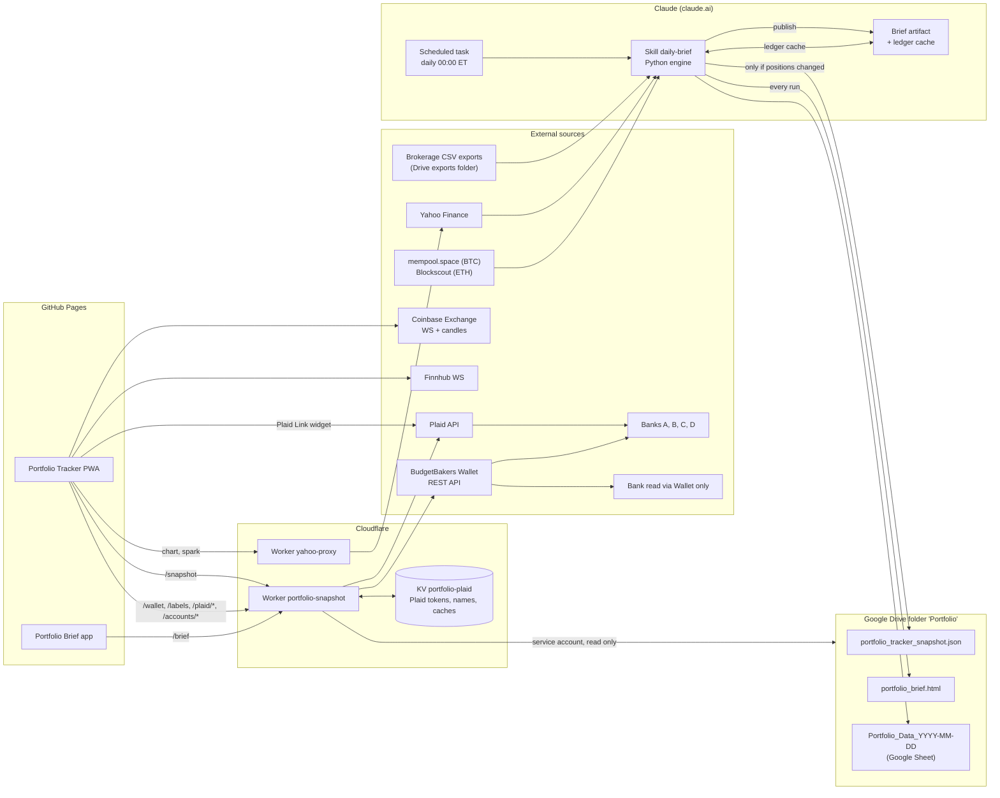
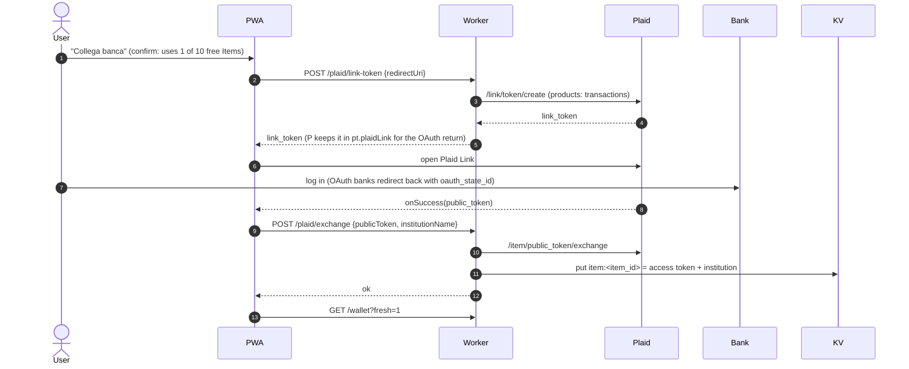

# Portfolio system: architecture and data flows

Status as of 2026-11-18. This document describes how the Portfolio Brief, the Portfolio Tracker
PWA, the two Cloudflare Workers and the external data sources fit together. It lists secret
**names** and where they live, never their values.

## 1. Components

| Component | What it is | Where it runs | Code |
|---|---|---|---|
| **Portfolio Brief** | Daily analysis of the brokerage account plus BTC and ETH wallets: valuation, P&L, XIRR/TWR, VaR, projections, PDF/XLSX | Claude scheduled task "Daily portfolio brief", every day at 00:00 America/New_York (fires a few minutes later) | Claude plugin `portfolio-brief` v0.9.1, skill `daily-brief`, Python engine in `skills/daily-brief/scripts/engine` |
| **Brief artifact** | The published Portfolio Brief dashboard on claude.ai; also stores the ledger cache (`ledger_cache_v2.wasm`, xz JSON) | claude.ai | written by the brief |
| **Portfolio Tracker** | Live PWA: positions at real-time prices, charts, returns, bank accounts and net worth | GitHub Pages (static, holds no data) | this repo: `index.html` (markup, styles, CSP, a hashed loader script), `tracker.js` (positions, charts, returns), `loader.js` (connection, snapshot, bank accounts, Plaid), `sw.js`, `manifest.json` |
| **Portfolio Brief app** | Static page that shows the latest `portfolio_brief.html` | GitHub Pages, separate repository (not covered in detail here) | separate repo |
| **Worker `portfolio-snapshot`** | Authenticated backend of both apps: Drive files, bank balances (Wallet + Plaid), Plaid linking | Cloudflare Workers (free plan) | `workers/portfolio-snapshot/worker.js` |
| **Worker `yahoo-proxy`** | CORS proxy for Yahoo Finance `/v8/finance/chart` and `/v8/finance/spark` only | Cloudflare Workers | source embedded in `index.html` (`#worker-src`) |
| **CLI `tools/wallet_balances.py`** | Command-line print of the Wallet balances (same logic as `/wallet`, Wallet only) | anywhere with Python 3 | `tools/wallet_balances.py` |

External data sources: brokerage CSV exports (Google Drive), Yahoo Finance, mempool.space (BTC
xpub), Blockscout (ETH address), Coinbase Exchange (WebSocket and candles), Finnhub (WebSocket
trades), BudgetBakers Wallet REST API, Plaid.

## 2. System diagram



## 3. Portfolio Brief (daily, unattended)

Trigger: scheduled task "Daily portfolio brief" (`CRON_TZ=America/New_York 0 0 * * *`), which invokes
`portfolio-brief:daily-brief`. Messages are in Italian. The final reply also shows the brokerage and crypto
separately (value, day change, all-time P&L, MWR per year).


Engine facts worth knowing (from the plugin README):

- **Inputs:** brokerage CSV exports, Yahoo Finance prices, on-chain balances for the BTC xpub and
  ETH address in `config.json`.
- **Ledger:** merged export rows are cached in the artifact (cache version 5) and replayed on every
  run. Pending rows in an export count as confirmed and are dropped once a later export shows them
  completed.
- **Linked brokerage accounts:** journals to and from the owner's other accounts at the same broker
  are treated as CD purchases and redemptions (a CD position at cost), not as contributions or
  withdrawals.
- **Return by deposit** (`deposits.py`): every deposit is its own lot; lots add up to the brokerage
  value and P&L, checked on every run.
- **Splits:** a "DISTRIBUTION OF STOCK" row scales open lots; a split Yahoo reports before the
  export arrives is applied provisionally and flagged.
- **Tracker snapshot** (`portfolio_tracker_snapshot.json`): positions, value history, the Yahoo proxy
  URL and Finnhub key, dated external cash flows, XIRR figures, daily flows for a live TWR, the
  benchmark TWR index (iShares AOA, 80/20), and the days a market position changed. It is replaced
  only when the positions fingerprint changes; uploads go by file reference, never inline.
- **Config:** `config.json` holds crypto lots, wallets, benchmarks, wrap fee rate, inflation,
  projection target (2055-01-01), contribution scenarios, VaR lookback and data fixes. Changing it
  means editing the file and reinstalling the plugin.

## 4. Portfolio Tracker PWA

### 4.1 Boot and positions snapshot

1. On first use the page asks for the Worker URL and the Worker `TOKEN` ("Collega lo snapshot").
   Both stay in this browser (`localStorage` keys `pt.conn`, plus a copy of the last snapshot in
   `pt.remote` to open offline).
2. `GET /snapshot` with `Authorization: Bearer <TOKEN>` and `If-None-Match`; the Worker answers
   `304` when the Drive file did not change. Cloudflare marks the ETag weak (`W/"..."`) when it
   compresses the answer and removes it from HTML answers (`/brief`), so the Worker compares
   `If-None-Match` weakly and also sends the value in `X-File-Version`, which the brief app reads.
   As a second guard, a `200` carrying the same snapshot as the cached one is treated as unchanged
   (applying it would reset live prices, price history, WebSockets and the chart).
3. Rechecks when the app returns to the foreground after 10 minutes, and every 30 minutes while
   visible. A snapshot whose `config` changed reloads the page.
4. `sw.js` caches only the same-origin app shell (network first, 2.5 s timeout); every
   cross-origin call (prices, Worker) always goes to the network.
5. In the background nothing is drawn: prices keep arriving into memory, the clock, KPIs, table and
   chart wait, and everything is redrawn at once when the app comes back to the foreground. KPI
   writes that would not change the page are skipped, and the price-independent part of the
   expected shortfall is cached per history load and view.

### 4.2 Live prices

| Asset | Live source | History |
|---|---|---|
| Crypto | Coinbase Exchange WebSocket (`wss://ws-feed.exchange.coinbase.com`) | Coinbase candles, Yahoo as fallback |
| Stocks, ETFs | Finnhub WebSocket trades (key from the snapshot, can be turned off in Settings) plus Yahoo spark polling through `yahoo-proxy` (every `pollSec`, default 30 s, with the market open; 10 min when closed) | Yahoo chart through `yahoo-proxy` |
| Mutual funds | daily NAV only | Yahoo |
| CDs, cash | fixed value from the snapshot | n/a |

KPIs (value, day change, open/closed/total P&L, XIRR, TWR, benchmark TWR) are recomputed from
positions × live prices plus the brief's flows and history in the snapshot.

**Loss vs expected shortfall.** Next to the day change, "Perdita / ES 95%" shows a losing day as a
share of the one-day 95% expected shortfall of the current view (yellow beyond the VaR, red beyond
the ES; on a positive day only the ES). Same method as the brief's `hist_es95_1d`, computed in the
browser because the snapshot does not carry it: daily closes of every market position over the last
420 days (Yahoo, Coinbase for crypto), the last 250 days on which every symbol has a return, applied
to the values at the start of the day (qty × reference price of the day change); ES = mean P&L at or
below the 5% quantile (numpy's linear quantile). The grid is New York trading days, with crypto at
its UTC close of the same date; a crypto-only view uses calendar days. Days not yet closed are left
out, and the history is read again when the New York or UTC date changes. CDs and cash carry no price
risk; positions without history are listed in the tooltip as excluded.

**Time zone.** Midnight (start of daily and weekly candles, the day's change, the day rollover) and
every time shown follow one time zone: the device's by default (on a phone it follows the location
when the clock is set automatically, and the app picks up a change within a second), or one chosen
in Settings or by tapping the clock (`localStorage` `pt.tz`; empty = automatic). The clock shows its
short name. Offsets come from `Intl.DateTimeFormat` (cached per 15 minutes), so DST is handled per
zone. Chart times are bars shifted to that zone's wall clock (Lightweight Charts renders UTC), so a
daily candle shows its own date on either side of UTC.

**NYSE pill.** Next to the dot, the time to the next bell of the regular session ("chiude tra 1h
05m", "apre tra 2g 16h"), from the same NYSE calendar used for the dot (weekends, holidays,
13:00 early closes).

**Chart history and periods.** Candles are hourly, 4-hour, daily or weekly (nothing under one hour).
The chart always holds the whole history the interval allows, and a period button (3M, 1A, Max, ...)
only zooms into it, with no new download; so indicators, and everything computed on the bars, are the
same whatever the period. Daily and weekly views load daily bars from 2015 up to a year ago and hourly
bars for the last year (so recent candles split at local midnight, crypto included, as before); hourly
and 4-hour views load the last 366 days. Max starts when every symbol of the view has a history; the
other periods keep a younger symbol at its first price before that (as they always did), so the loaded
history reaches at least 5 years back. "Nel periodo" and the legend's "dall'inizio" are measured from
the first bar of the selected period. The real history (Storico reale) is always loaded whole too.

**Drawing tools.** Four buttons at the bottom left of the chart, TradingView style:
- 📏 ruler: drag, or tap the start and then the end. A box shows the move between the two points:
  value change and percentage (from the start value, whatever the price scale: $, % or log), number of
  bars, time span and dates. Both ends snap to the nearest O/H/L/C of the bar (the close on line and
  area charts) within 14 px. It is one shot: the measure stays until the next press on the chart, Esc
  or a change of view, interval or mode.
- 📍 marker: an arrow above a bar with an optional note (also shown in the legend for that bar);
  tapping a bar that has one removes it. A marker keeps its time, so it lands on the bar holding it
  in every interval (a marker made on a daily or weekly bar goes on the first intraday bar of that day).
- ═ level: a horizontal line at the tapped value with an optional note; tapping near one removes it.
- 🗑 removes every marker and level of the view.
- ƒx indicators: simple and exponential moving averages and Bollinger bands over the price, RSI (with
  the 70/30 lines) and MACD (line, signal, histogram) each in a pane of its own under it, at most two
  such panes. Several of each can be added with their own periods (e.g. SMA 50 and SMA 200), at most
  8 in all; the list applies to every view.

The ruler is a series primitive (`attachPrimitive`), drawn by the chart itself, so it follows scroll,
zoom and price-axis drags; markers use `createSeriesMarkers` and levels `createPriceLine`. While a tool
is active a transparent layer over the chart takes the pointer (and stops the page from scrolling under
the finger); with no tool active the chart behaves exactly as before. Markers and levels are kept per
view (Tutto, the broker, Crypto, or Simboli… with its set of symbols).

Lightweight Charts has no indicators of its own (TradingView keeps them in its larger charting
products): they are computed in the app from the bars of the view (SMA; EMA seeded with the SMA of its
first n values; Bollinger with the population standard deviation; Wilder's RSI; MACD from those EMAs)
and drawn as series. Overlays never drive the price scale (`autoscaleInfoProvider: () => null`), drop
values at or below zero on the log scale, and are hidden on the % scale, where the library measures
each series from its own first value and an average would sit away from its price. The chart grows
with each indicator pane so the price pane keeps about its height. Value labels use a per-series `$`
format (not `localization.priceFormatter`, which would also reach the RSI and MACD panes).

**Sync of drawings and indicators.** Both are shared by every device through the Worker, in `PLAID_KV`:
- `drawings` (`GET /drawings`, `POST /drawings`): changes are idempotent operations, `add` (by id,
  replacing), `remove` and `clear`, one per request or `{ ops: [...] }` (at most 200, applied all or
  nothing); the answer holds every drawing. Limits: 100 views, 300 markers and 100 levels per view.
- `indicators` (`GET /indicators`, `POST /indicators` with the whole list, at most 8, each parameter
  checked against its range).

The app applies a change at once, keeps a local copy (`localStorage` `pt.drawings`, `pt.indicators`)
and a queue of changes not yet confirmed (`pt.drawingsPending`, `pt.indicatorsDirty`), and syncs when
it opens, when it comes back to the foreground, every 2 minutes and after each change. Offline, or with
a Worker that does not know these routes, it keeps working on the local copy and sends the queue later;
a change the Worker refuses as invalid (400) is dropped. The first sync in a browser uploads the
markers and levels drawn there before the sync existed (`pt.drawingsSynced`).

### 4.3 Bank accounts and net worth

The "Conti" section and the "Patrimonio totale" KPI come from `GET /wallet` on the Worker.

```mermaid
sequenceDiagram
  autonumber
  participant P as PWA
  participant W as Worker portfolio-snapshot
  participant K as KV portfolio-plaid
  participant B as Wallet REST API
  participant L as Plaid
  P->>W: GET /wallet (Bearer TOKEN) [?fresh=1 for "Aggiorna ora"]
  alt cached answer younger than 10 min (1 min when fresh=1)
    W-->>P: cached summary
  else
    par Wallet
      W->>B: GET /accounts (paginated)
    and FX
      W->>W: EURUSD from Yahoo Finance (fallback: Wallet's rate on the latest EUR record)
    and Plaid, per linked bank
      W->>K: list item:* (access tokens)
      W->>L: /accounts/balance/get (live, max 1 per 5 min per bank) or /accounts/get (cached), /item/get
      W->>L: /transactions/get (last 30 days, pending flags)
      W->>L: /transactions/refresh (forced reads only, max 1 per 5 min per bank)
    end
    W->>W: drop Investment accounts, map Wallet accounts
    W->>W: one copy of a joint account seen through two Plaid logins
    W->>W: Plaid accounts replace their Wallet twin (same currency + last 4 digits)
    W->>W: pending guards, totals by currency, USD/EUR totals, credit utilization
    W-->>P: summary (no tokens in it)
  end
  P->>P: add the manual accounts ("manual" in /wallet, copy in localStorage pt.extras) to totals
  P->>P: Patrimonio totale = portfolio at live prices (CD and cash included) + accounts total USD
  P->>P: EUR lines under Patrimonio and Valore = USD / EURUSD from /wallet; invested share = portfolio / Patrimonio
```

**Private labels:** the public code holds placeholders only. `tracker.js` uses `BROKER` (display
name of the brokerage and the `account` value of its positions in the snapshot) and `BK` (the
snapshot's field name for its series and flows: `history[BK]`, `history['flow_' + BK]`,
`flows[BK]`); the broker view's internal key is `broker`. The real values come from `GET /labels`
(KV key `labels`, e.g. `{"broker": "...", "brokerKey": "..."}`), are kept in `localStorage`
(`pt.labels`) and refreshed in the background; the first start without them waits for the Worker.
Without labels the app shows "Broker" and the broker view stays empty.

**Custom names:** the ✎ next to each account renames it for every device (`POST /accounts/rename`,
stored in `PLAID_KV` under `names`, keyed by the account id in `/wallet`; an empty name restores the
original, still shown in the tooltip). Names are applied last, so `CREDIT_LIMITS` and the Wallet/Plaid
matching keep using the original names. The local manual account is renamed in the browser only.

**Table layout:** accounts sorted alphabetically (Italian collation, case-insensitive). Columns:
balance (with pending under it), credit used, last posted transaction ("Ultimo mov.", hidden on
phones) and last sync ("Ultima sync"/"Sync", date only). The last sync is Plaid's
`status.transactions.last_successful_update` from `/item/get` (or the time of the live balance read)
for Plaid accounts, and the Wallet account's `updatedAt` for Wallet bank-synced accounts (Wallet has no
"last sync" field; `updatedAt` moves on each sync round, so it is an approximation). A Wallet
bank-synced account whose last sync is older than 24 hours gets a ⚠️ next to its name; manual accounts show "—". A green dot before
the sync date marks a Plaid balance read in real time (within the last 5 minutes); no dot means
Plaid's cached balance. A real-time read says nothing about the transactions: the pending list only
changes when Plaid refreshes the bank's transactions, so Plaid accounts show a second line under the
date, "mov. HH:MM" (or the day if not today), with `last_successful_update` (`txUpdatedAt` in
`/wallet`).

**Plaid link health:** a Plaid account gets the ⚠️ only when Plaid itself says the link is broken,
never because its transactions are old (some banks go days without new transactions). The Worker
builds `health` per Item (also copied on each account) on every Plaid read, from: a call refused with a
link error code (`ITEM_LOGIN_REQUIRED`, `INVALID_CREDENTIALS`, `ITEM_LOCKED`, consent errors, ...),
`item.error` in `/item/get`, `item.consent_expiration_time` in the past, or
`status.transactions.last_failed_update` newer than `last_successful_update` with no success for 24
hours. `health.reason` is `item_error`, `consent_expired` or `update_failing`. If `/item/get` does not
answer and no call says otherwise, the last known health is kept. A broken Item also shows the reason
and a "Riconnetti" button (Plaid Link update mode) in the list of linked banks, even when Plaid still
serves its cached balances.

**Latest transactions:** tapping an account row opens, under it, how its balance is made and its
latest transactions (`GET /accounts/transactions?id=<account id>`, loaded on open, reloaded after
each refresh while open).
- Plaid accounts: no Plaid call; the transactions come from the last read (30 days, up to 250 per
  bank, kept in `plaid:summary` and never sent with `/wallet`). The 20 newest per account plus any
  counted pending item, each marked **pending** (added to the bank's posted balance), **excluded**
  (pending already replaced by its posted transaction, guard 1) or **posted** (already inside the
  bank's balance: shown as context, not summed). The header shows posted + pending = balance.
- Wallet accounts: the 20 latest records over the last year (one Wallet call, cached 2 minutes in
  the Worker). Wallet's balance is the sum of all records, so every one of them is part of it;
  `uncleared` records are marked "non confermato", transfers "trasferimento".
- The local manual account has no detail.

Per-account source tags in the table: **P** = Plaid (bank balance as of Plaid's latest refresh, pending included),
**W** = Wallet bank sync, **M** = entered by hand (Wallet cash accounts or the local manual account).

Balance rules:

- **Wallet accounts:** Wallet's computed balance (`initial + incomes - expenses` over posted records,
  `rawCurrentBalance`, signed). Wallet's API exposes no pending transactions. Credit cards: owed =
  max(0, -balance).
- **Plaid accounts:** posted balance from the bank. Real-time `/accounts/balance/get` is rate limited
  in Production to 5 per minute and 30 per hour per Item (`BALANCE_LIMIT`, hit on 2026-11-16 when every
  refresh of every isolate called it). The Worker now calls it at most once every 5 minutes per Item,
  reuses that read for the next 5 minutes, and otherwise reads Plaid's cached balances with
  `/accounts/get` (15 per minute per Item). After a `BALANCE_LIMIT` answer it falls back to
  `/accounts/get` in the same request and suspends real-time reads for that Item for 1 hour. The state
  (last real-time read, block) travels in the shared `plaid:summary` cache, so no extra KV writes.
  Balance = posted balance (credit and loan: `-current`, depository: `current`) plus the listed pending
  transactions, then the two guards below. The raw balances of a real-time read are kept in the
  shared cache (never sent to the app) so the transactions can be read again while that read is reused.
- **Slow banks (soft deadline and background completion):** real-time reads and
  `/transactions/refresh` wait for the bank and can take 10 to 20 seconds or more. Each bank's answer
  is built 8 seconds after its calls start (`PLAID_SOFT_MS`): a real-time read still running is
  replaced by `/accounts/get` (`liveLate` in the status), a refresh still running counts as requested
  (`txRefreshUnconfirmed`). Those calls are not abandoned: `ctx.waitUntil` lets them finish after the
  response (up to 25 seconds), then the bank is rebuilt and merged into `plaid:summary`
  (`background` in its status), so the next read shows them (the PWA reads again 90 seconds after
  "Aggiorna ora"). Writes to `plaid:summary` merge instead of overwrite: the stored value is read
  again and, per bank, the result with the newest `builtAt` wins, so a background completion and a
  concurrent read cannot erase each other (the worst case is one bank showing its previous result
  until the next read). One KV key for all banks keeps the writes within the free plan's 1,000 a day.
  `/transactions/get`, `/item/get` and `/accounts/get` get 12 seconds. Plaid and Yahoo run alongside
  Wallet, and the PWA waits up to 40 seconds for `/wallet`. Each bank's status carries `ms`, the
  duration of each call.
- **Forced reads:** "Aggiorna ora" always reaches Plaid (until 2026-11-17 a forced read within a
  minute of an automatic one was answered from cache and did nothing). The message under the button
  says, per bank, whether the refresh was requested, already requested less than 5 minutes earlier
  (`txRefreshThrottled`), or whether a real-time balance is still arriving in the background.
- **On-demand transaction refresh:** a forced read ("Aggiorna ora") also calls
  `/transactions/refresh` for each bank, at most once every 5 minutes per Item (Plaid allows 2 per
  minute and 120 per hour). Plaid fetches asynchronously, so the PWA reads `/wallet?fresh=1` again
  90 seconds later. If Plaid refuses the call as not enabled for the account (it is an add-on), the
  error is shown in the bank's status line and the call is not retried for 24 hours. Plaid answers the
  call only after the bank does (4 to 10 seconds observed, more for some banks); a slow answer is
  handled as above, never as an error.
- **Unlisted holds (credit cards):** some cards count an authorisation in their available credit
  without Plaid listing it as a pending transaction (seen on 2026-11-17: a 92 USD hold on a card in
  credit). For credit cards the Worker computes what the bank holds, `(limit - available) - posted
  debt`, and counts whatever exceeds the listed pending items, even by one cent, as pending too
  (`pending.unlisted`, `check: "inferred"`, shown with ≈ and as a separate "dal disponibile" line in
  the detail). Only done when the transactions were read. Risk: a bank that lowers the available
  credit for other reasons (blocks, payments being processed) shows that amount as pending.
- **Credit limits:** Plaid's `limit`, overridden by the `CREDIT_LIMITS` secret (keyed by Wallet
  account name); Wallet's own limit as a last resort. The overall utilization under the table is in USD:
  a EUR card is converted at the EURUSD rate, a card in another currency is left out of it.
- **Loans:** Plaid `loan` accounts (mortgage, auto, student) are debts: `current` is the principal still
  owed, so the balance is `-current` (type `Loan`, no credit line, pending check `unverified`).
- **Joint accounts across Plaid logins:** an account visible from two logins at the same bank is kept
  once (same institution name, last 4 digits, currency and type, from two different Items); the copy
  with a real-time balance wins. Two accounts with the same key inside one Item stay separate.
- **FX:** EURUSD from Yahoo Finance (`EURUSD=X`, last market price), the same source as the brief;
  if Yahoo does not answer, the rate Wallet applied to the latest EUR record (shown as such).
- **If a Plaid bank fails**, its accounts fall back to the Wallet data and the bank is listed with its
  Plaid error code; login errors show a "Riconnetti" button (Plaid update mode, uses no new Item).
- **If Wallet fails** (error, timeout or rate limit) and Plaid is configured, `/wallet` still answers:
  Plaid accounts are fresh, and Wallet-only accounts (the bank read only through Wallet, cash) come from the last successful Wallet
  read, kept in memory and in `PLAID_KV` under `wallet:last` (or are missing if there is none). The
  answer carries `wallet: {ok, error, staleSince}` and the tracker shows the warning under the table.
  Wallet uses its own aggregators (its terms name Salt Edge and Yodlee, not Plaid), so the two bank
  feeds do not share an aggregator.

Pending guards (Worker, per Plaid account):

1. **Dedupe (acts):** a pending transaction named by a posted one in `pending_transaction_id` is
   ignored. This is the only rule that removes a pending item, because it rests on an explicit link.
2. **Bank cross-check (reports only):** the computed balance is compared with the bank's figure that
   should include pending items (credit: posted balance minus what the bank holds, `(limit -
   available) - posted debt`, which stays right for a card in credit, whose available credit ignores
   the credit balance; until 2026-11-21 it used `-(limit - available)`, which flagged every card in
   credit with "?"; depository: `available`). Outcome per account: `ok` (check mark: the figures
   agree), `differs` ("?": they disagree), `inferred` (≈: unlisted holds were added), `unverified` (no
   available balance from the bank). It never changes the balance. An earlier version clamped the
   balance to the bank figure; it was withdrawn on 2026-11-16 because one card issuer's balances via Plaid
   report `available` without pending items, which made a real pending authorization disappear.
   From balances alone, "the bank already counts this pending" and "the bank's available ignores
   pending" look identical.
3. **Consequence:** a pending item that the bank reverses or finalizes with a different amount stays
   as Plaid lists it until Plaid's next transaction update (typically a few hours).

### 4.4 Linking a bank with Plaid



If the redirect URI is not registered in the Plaid dashboard, the PWA retries without it and OAuth
banks use a popup instead.

"Cerca istituto" calls `GET /plaid/institutions?q=<name>`, a read-only lookup of Plaid's
institution list with the products each institution supports; it links nothing and uses no Item.

Linked as of 2026-11-16: 5 of the 10 Trial Items (banks A, B, C and D, one of them through two separate
logins of the household). One more bank is read only through Wallet.

### 4.5 Manual accounts and settings

- **Manual accounts** under the Conti table: any number of them (name, amount, USD/EUR, a "±" button
  for debts), added with the form below the table. Amounts are typed Italian style: the comma is the
  only decimal separator and dots may only group thousands (`1250,50`, `1.250,50`); anything else,
  `1250.50` included, is refused with an error message instead of being guessed. In the table, ✎ or a tap on the row opens an
  editor for name, amount and currency, ✕ (in the empty sync column) deletes the account after a
  confirmation. Shared by every device: the Worker keeps them in `PLAID_KV` (`manual`), changes go
  through `POST /accounts/manual` (`upsert` or `delete` of one account, answered with the whole list),
  `/wallet` returns the list as `manual`, and `GET /accounts/manual` reads it alone when the app opens
  with balances recent enough to skip `/wallet`. Each browser keeps a copy (`pt.extras`) to start
  without network; the first time a browser syncs, accounts that existed only there (from the
  local-only versions, `pt.extras` or the older single `pt.extra`) are uploaded, then `pt.extrasSynced`
  is set. Counted in the totals and in the net worth.
- **Settings modal:** time zone, Yahoo proxy URL and token, Finnhub key, poll interval, snapshot import/export.

## 5. Refresh cadence

| Layer | Cadence |
|---|---|
| Brief | once a day (00:00 ET) |
| Positions snapshot in the PWA | on open, on foreground after 10 min, every 30 min while visible |
| Crypto prices | real time (Coinbase WS) |
| Stock and ETF prices | real time trades (Finnhub) + Yahoo poll every 30 s with the market open |
| Bank balances in the PWA | on open, on foreground, every 10 min; "Aggiorna ora" forces it (max once a minute) |
| Worker `/wallet` cache | 10 min, per Worker isolate; forced reads always rebuild it (the Wallet call itself keeps a 1 min floor: a Wallet read younger than that is reused) |
| Plaid balances | real time at most every 5 min per bank (`/accounts/balance/get`), otherwise Plaid's latest refresh (`/accounts/get`); Plaid answers are cached for all Worker isolates in `PLAID_KV` (`plaid:summary`), so Plaid is called at most once per 10 min, plus each forced read |
| Plaid pending list | Plaid's own transaction updates, typically a few times a day; "Aggiorna ora" asks for one now (`/transactions/refresh`, max once per 5 min per bank) |
| Wallet (banks not linked through Plaid) | whenever Wallet syncs the bank; opening the Wallet app forces it; posted transactions only |

## 6. Configuration and secrets

Worker `portfolio-snapshot` (Cloudflare → Workers → Settings → Variables and Secrets):

| Name | Type | Purpose |
|---|---|---|
| `TOKEN` | secret | shared secret the apps send as `Authorization: Bearer` |
| `GOOGLE_SA_KEY` | secret | service account JSON key; the account can read only the "Portfolio" folder |
| `FOLDER_ID` | text | Drive folder id |
| `ALLOWED_ORIGIN`, `SNAPSHOT_NAME`, `BRIEF_NAME` | text, optional | CORS origin and file names |
| `WALLET_API_TOKEN` | secret | BudgetBakers Wallet REST API token (Premium); also allows writes, keep it server side |
| `CREDIT_LIMITS` | secret | JSON `{"<Wallet account name>": limit}` |
| `PLAID_CLIENT_ID` | text | Plaid client id |
| `PLAID_SECRET` | secret | Plaid Production secret |
| `PLAID_ENV` | text, optional | `production` (default) or `sandbox` |
| `PLAID_COUNTRY_CODES` | text | comma-separated Plaid country codes for Link and the institution search (kept out of the code) |
| `PLAID_KV` | KV binding | namespace `portfolio-plaid`: `item:<item_id>` (one per linked bank: access token, institution, products), `names` (custom account names), `manual` (manual accounts), `drawings` (chart markers and levels), `indicators` (chart indicators), `labels` (private display labels), `plaid:summary` (shared Plaid cache), `wallet:last` (last good Wallet read) |

Elsewhere:

- **Browser `localStorage`:** `pt.conn` (Worker URL + TOKEN), `pt.remote` (last snapshot),
  `pt.wallet` (last `/wallet` answer), `pt.extras` (copy of the manual accounts), `pt.extrasSynced`, `pt.labels` (private labels), `pt.plaidLink` (link token during
  OAuth), `pt.settings` and other UI preferences.
- **Snapshot `config`:** Yahoo proxy URL and Finnhub key, written by the brief.
- **Brief:** `config.json` in the plugin; constants (artifact URL, Drive folder ids) in `SKILL.md`.
- **CLI:** `WALLET_API_TOKEN` and optional `WALLET_CREDIT_LIMITS` environment variables.

## 7. Security model

- The GitHub repository and the Pages sites are public and hold no data and no secrets.
- Every data route on the Worker requires `TOKEN` (constant-time comparison); `/` is a liveness check.
- Wallet and Plaid credentials and the Plaid access tokens never reach the browser; `/wallet`
  answers contain balances only.
- The Drive service account is limited by sharing to one folder, read only.
- Bank logins happen inside Plaid Link or on the bank's own OAuth page; neither the PWA nor the Worker
  sees them.
- Wallet fair use: after a 429 the Worker stops calling Wallet for the `Retry-After` time (at least
  60 s) and serves the last answer; forced reads are limited to one a minute on both sides.
- **XSS:** every string from outside the page (snapshot symbols, names and dates, Worker labels and
  account names, Yahoo error messages, imported files) is data, never markup. `tracker.js` passes it
  through `esc()` in every HTML template; `loader.js` builds its DOM with `textContent` only; messages
  use `textContent`. Keep this rule for new code: the Worker `TOKEN` sits in `localStorage` (`pt.conn`),
  so script injected into the page could read it.
- **Content-Security-Policy** (meta tag in `index.html`), the second line of defence: only the small
  loader script at the end of `index.html` may run, allowed by its SHA-256 hash, and `'strict-dynamic'`
  extends that trust to the scripts it adds (`lightweight-charts.js`, `tracker.js`, `loader.js`) and to
  the ones they load (Plaid Link, the XLSX reader from cdnjs). Inline event handlers and `javascript:`
  URLs injected through data are blocked. Plaid also needs `frame-src` and `img-src` on
  `cdn.plaid.com`; the service worker needs `worker-src 'self'`. Editing `tracker.js` or `loader.js`
  needs no CSP change; editing the inline loader script means recomputing its hash
  (`printf %s "<script body>" | openssl dgst -sha256 -binary | base64`, body = everything between
  `<script>` and `</script>`), otherwise the page stays blank.

## 8. Limits and known behaviour

- **Wallet:** about 300 requests/hour (shared by REST and MCP); no pending transactions; no API to
  trigger a bank sync; balances are computed by Wallet from imported records, so a missed or
  duplicated import shifts them. Bank sync timing varies by bank (one card issuer was observed lagging by a day).
- **Plaid Trial plan:** 10 Items; removing an Item does not free its slot and linking the same bank
  twice uses two. Use "Riconnetti" (update mode) for expired logins. OAuth banks may need the PWA URL
  in "Allowed redirect URIs".
- **Banks not linked through Plaid** are read through Wallet only.
- **Alternatives evaluated:** Teller (one of the banks not covered, developer sign-up not available),
  SimpleFIN (coverage and pending support not verified), Enable Banking (coverage not verified).
- **Cloudflare free plan:** 100k Worker requests/day, KV 100k reads and 1k writes a day; far above
  this use (about 300 KV writes a day: the two caches every 10 minutes).
- **The brokerage via Plaid Investments** was tried on 2026-11-16 and reverted: Plaid lists the
  broker with `investments`, but the login stops with "Action required with your account" and nothing
  on the broker's site fixes it. The brief keeps using the CSV exports.

### Open issues (not fixed yet)

- **Manual accounts and names, concurrent edits:** `POST /accounts/manual` and `/accounts/rename` read,
  change and write one KV key; two edits from two devices in the same second can lose one of them
  (KV has no transactions). Harmless for a single user editing one thing at a time.
- **Last 4 digits matching:** a new Plaid account with the same last 4 digits and currency as an
  unrelated Wallet account would replace it.

## 9. Operations

- **Deploying the Worker:** upload `workers/portfolio-snapshot/worker.js` through the Cloudflare API
  (`PUT /accounts/<account>/workers/scripts/portfolio-snapshot`, multipart with `metadata` that sets
  `main_module`, `compatibility_date`, the `PLAID_KV` and `PLAID_CLIENT_ID` bindings, and
  `keep_bindings: ["plain_text", "secret_text", "kv_namespace"]` so existing secrets survive), or paste
  the file into the Cloudflare dashboard editor. Keep the repo copy and the deployed copy identical.
- **Deploying the PWA:** push to `main`; GitHub Pages rebuilds in about 40 s. Reopen the app (the
  service worker serves the new shell on the next network-first load). Adding a file to the app shell
  means listing it in `SHELL` in `sw.js` and bumping `CACHE`.
- **Linking banks:** one bank at a time, once each; check coverage first with "Cerca istituto".
- **Checking a Plaid bank after linking:** compare the balance and the "in sospeso" line with the bank
  app; a check mark means the bank's available figure confirms the pending amount.
