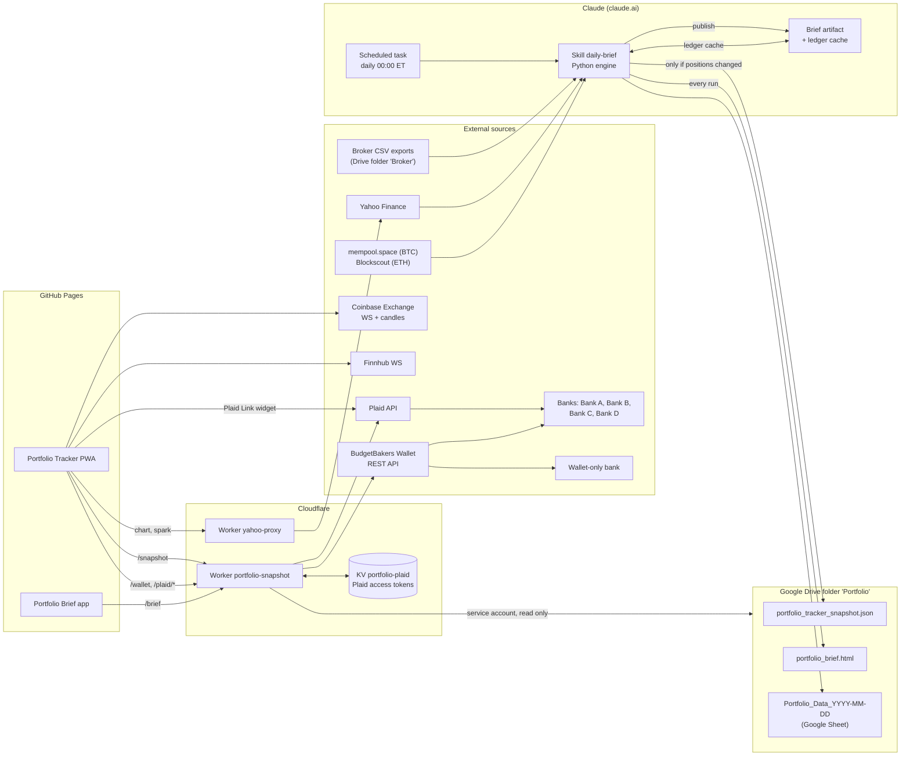
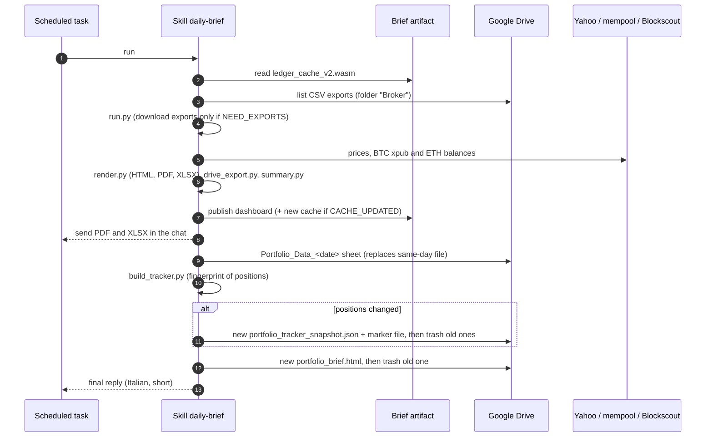
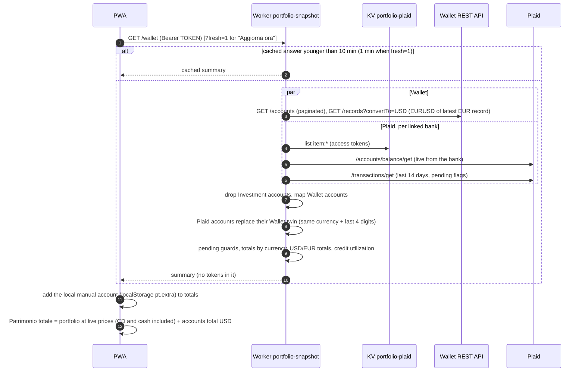
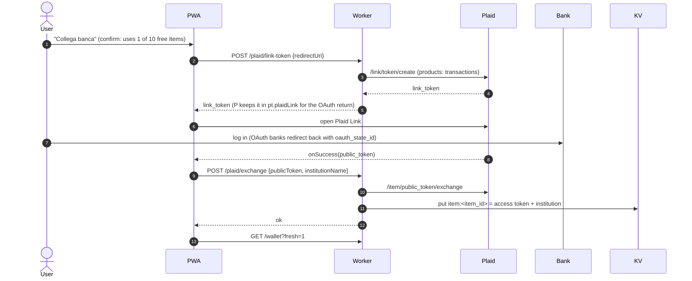

# Portfolio system: architecture and data flows

Status as of 2026-11-16. This document describes how the Portfolio Brief, the Portfolio Tracker
PWA, the two Cloudflare Workers and the external data sources fit together. It lists secret
**names** and where they live, never their values.

## 1. Components

| Component | What it is | Where it runs | Code |
|---|---|---|---|
| **Portfolio Brief** | Daily analysis of the Broker account plus BTC and ETH wallets: valuation, P&L, XIRR/TWR, VaR, projections, PDF/XLSX | Claude scheduled task "Daily portfolio brief", every day at 00:00 America/New_York (fires a few minutes later) | Claude plugin `portfolio-brief` v0.9.1, skill `daily-brief`, Python engine in `skills/daily-brief/scripts/engine` |
| **Brief artifact** | The published dashboard "Portfolio Brief" on claude.ai; also stores the ledger cache (`ledger_cache_v2.wasm`, xz JSON) | claude.ai | written by the brief |
| **Portfolio Tracker** | Live PWA: positions at real-time prices, charts, returns, bank accounts and net worth | GitHub Pages (static, holds no data) | this repo: `index.html`, `sw.js`, `manifest.json` |
| **Portfolio Brief app** | Static page that shows the latest `portfolio_brief.html` | GitHub Pages, separate repository (not covered in detail here) | separate repo |
| **Worker `portfolio-snapshot`** | Authenticated backend of both apps: Drive files, bank balances (Wallet + Plaid), Plaid linking | Cloudflare Workers (free plan) | `workers/portfolio-snapshot/worker.js` |
| **Worker `yahoo-proxy`** | CORS proxy for Yahoo Finance `/v8/finance/chart` and `/v8/finance/spark` only | Cloudflare Workers | source embedded in `index.html` (`#worker-src`) |
| **CLI `tools/wallet_balances.py`** | Command-line print of the Wallet balances (same logic as `/wallet`, Wallet only) | anywhere with Python 3 | `tools/wallet_balances.py` |

External data sources: Broker CSV exports (Google Drive), Yahoo Finance, mempool.space (BTC
xpub), Blockscout (ETH address), Coinbase Exchange (WebSocket and candles), Finnhub (WebSocket
trades), BudgetBakers Wallet REST API, Plaid.

## 2. System diagram

## 3. Portfolio Brief (daily, unattended)

Trigger: scheduled task "Daily portfolio brief" (`CRON_TZ=America/New_York 0 0 * * *`), which invokes
`portfolio-brief:daily-brief`. Messages are in Italian. The final reply also shows Broker and crypto
separately (value, day change, all-time P&L, MWR per year).

Engine facts worth knowing (from the plugin README):

- **Inputs:** Broker CSV exports, Yahoo Finance prices, on-chain balances for the BTC xpub and
  ETH address in `config.json`.
- **Ledger:** merged export rows are cached in the artifact (cache version 5) and replayed on every
  run. Pending rows in an export count as confirmed and are dropped once a later export shows them
  completed.
- **Linked Broker accounts:** journals to and from the other Broker accounts are treated as
  CD purchases and redemptions (`CD position`, at cost), not as contributions or withdrawals.
- **Return by deposit** (`deposits.py`): every deposit is its own lot; lots add up to the Broker
  value and P&L, checked on every run.
- **Splits:** a "DISTRIBUTION OF STOCK" row scales open lots; a split Yahoo reports before the
  export arrives is applied provisionally and flagged.
- **Tracker snapshot** (`portfolio_tracker_snapshot.json`): positions, value history, the Yahoo proxy
  URL and Finnhub key, dated external cash flows, XIRR figures, daily flows for a live TWR, the
  benchmark TWR index (iShares AOA, 80/20), and the days a market position changed. It is replaced
  only when the positions fingerprint changes; uploads go by file reference, never inline.
- **Config:** `config.json` holds crypto lots, wallets, benchmarks, wrap fee rate, inflation,
  projection target (2055-01-01), contribution scenarios, VaR lookback and data fixes. Changing it
  means editing the file and reinstalling the plugin.

## 4. Portfolio Tracker PWA

### 4.1 Boot and positions snapshot

1. On first use the page asks for the Worker URL and the Worker `TOKEN` ("Collega lo snapshot").
   Both stay in this browser (`localStorage` keys `pt.conn`, plus a copy of the last snapshot in
   `pt.remote` to open offline).
2. `GET /snapshot` with `Authorization: Bearer <TOKEN>` and `If-None-Match`; the Worker answers
   `304` when the Drive file did not change.
3. Rechecks when the app returns to the foreground after 10 minutes, and every 30 minutes while
   visible. A snapshot whose `config` changed reloads the page.
4. `sw.js` caches only the same-origin app shell (network first, 2.5 s timeout); every
   cross-origin call (prices, Worker) always goes to the network.

### 4.2 Live prices

| Asset | Live source | History |
|---|---|---|
| Crypto | Coinbase Exchange WebSocket (`wss://ws-feed.exchange.coinbase.com`) | Coinbase candles, Yahoo as fallback |
| Stocks, ETFs | Finnhub WebSocket trades (key from the snapshot, can be turned off in Settings) plus Yahoo spark polling through `yahoo-proxy` (every `pollSec`, default 30 s, with the market open; 10 min when closed) | Yahoo chart through `yahoo-proxy` |
| Mutual funds | daily NAV only | Yahoo |
| CDs, cash | fixed value from the snapshot | n/a |

KPIs (value, day change, open/closed/total P&L, XIRR, TWR, benchmark TWR) are recomputed from
positions × live prices plus the brief's flows and history in the snapshot.

### 4.3 Bank accounts and net worth

The "Conti" section and the "Patrimonio totale" KPI come from `GET /wallet` on the Worker.

Per-account source tags in the table: **P** = Plaid (live bank balance, pending included),
**W** = Wallet bank sync, **M** = entered by hand (Wallet cash accounts or the local manual account).

Balance rules:

- **Wallet accounts:** Wallet's computed balance (`initial + incomes - expenses` over posted records,
  `rawCurrentBalance`, signed). Wallet's API exposes no pending transactions. Credit cards: owed =
  max(0, -balance).
- **Plaid accounts:** posted balance from the bank (credit: `-current`, depository: `current`) plus
  the listed pending transactions, then the two guards below.
- **Credit limits:** Plaid's `limit`, overridden by the `CREDIT_LIMITS` secret (keyed by Wallet
  account name); Wallet's own limit as a last resort.
- **FX:** EURUSD is the rate Wallet applied to the latest EUR record (not a live market rate).
- **If a Plaid bank fails**, its accounts fall back to the Wallet data and the bank is listed with its
  Plaid error code; login errors show a "Riconnetti" button (Plaid update mode, uses no new Item).

Pending guards (Worker, per Plaid account):

1. **Dedupe (acts):** a pending transaction named by a posted one in `pending_transaction_id` is
   ignored. This is the only rule that removes a pending item, because it rests on an explicit link.
2. **Bank cross-check (reports only):** the computed balance is compared with the bank's figure that
   should include pending items (credit: `limit - available`; depository: `available`). Outcome per
   account: `ok` (check mark: the figures agree), `differs` ("?": they disagree), `unverified` (no
   available balance from the bank). It never changes the balance. An earlier version clamped the
   balance to the bank figure; it was withdrawn on 2026-11-16 because one card issuer's balances via Plaid
   report `available` without pending items, which made a real pending authorization disappear.
   From balances alone, "the bank already counts this pending" and "the bank's available ignores
   pending" look identical.
3. **Consequence:** a pending item that the bank reverses or finalizes with a different amount stays
   as Plaid lists it until Plaid's next transaction update (typically a few hours).

### 4.4 Linking a bank with Plaid

If the redirect URI is not registered in the Plaid dashboard, the PWA retries without it and OAuth
banks use a popup instead.

Linked so far: Bank A, Bank B (checking and card), Bank C, Bank D (all with the Transactions
product).

### 4.5 Brokerage positions through Plaid Investments (Broker)

- **"Collega investimenti"** opens the same Link flow with `products: ["investments"]`; the item is
  stored with that product. Plaid lists Broker as "Broker Financial - My Financial Accounts",
  "Broker Financial Brokerage" and "Alight - Broker Financial", all with `investments`.
- `/wallet` shows an investment item as a status line only (accounts, positions, value). Its accounts
  are **not** added to the bank totals: the portfolio already counts them.
- `GET /plaid/holdings` returns each brokerage's accounts and holdings (ticker, CUSIP, type, quantity,
  institution price and value, cost basis).
- **"Confronta con il brief"** compares those holdings with the positions in the brief's snapshot:
  quantities per ticker (equal, different, one side only), cash (`Sweep` vs cash equivalents) and
  CDs/other untickered holdings by value. Crypto is excluded.
- **Pending trades count as settled**, as in the brief (which treats the export's "Pending
  Transactions" rows as confirmed). Plaid has no pending flag for investment transactions, and
  whether holdings already include an unsettled trade depends on the institution, so
  `/plaid/holdings` also returns the buys and sells of the last 10 days. A ticker whose gap equals
  those recent trades (holdings plus recent trades = brief) is shown as aligned, noted
  "operazione recente".
- The brief's CSV ledger stays the source of truth (history since 2022, linked-account CD logic,
  splits, deposit lots); Plaid is a check and a faster signal of position changes.
- `GET /plaid/institutions?q=<name>` is a read-only lookup of Plaid's institution list with supported
  products; it links nothing and uses no Item.

### 4.6 Local-only features

- **Manual account** under the Conti table (name, amount, USD/EUR, a "±" button for debts): stored in
  `localStorage` (`pt.extra`), counted in the totals and in the net worth, only in that browser.
- **Settings modal:** Yahoo proxy URL and token, Finnhub key, poll interval, snapshot import/export.

## 5. Refresh cadence

| Layer | Cadence |
|---|---|
| Brief | once a day (00:00 ET) |
| Positions snapshot in the PWA | on open, on foreground after 10 min, every 30 min while visible |
| Crypto prices | real time (Coinbase WS) |
| Stock and ETF prices | real time trades (Finnhub) + Yahoo poll every 30 s with the market open |
| Bank balances in the PWA | on open, on foreground, every 10 min; "Aggiorna ora" forces it (max once a minute) |
| Worker `/wallet` cache | 10 min (1 min floor for forced reads), per Worker isolate |
| Plaid balances | live from the bank on every Worker refresh |
| Plaid pending list | Plaid's own transaction updates, typically a few times a day |
| Wallet (the Wallet-only bank and any bank not on Plaid) | whenever Wallet syncs the bank; opening the Wallet app forces it; posted transactions only |

## 6. Configuration and secrets

Worker `portfolio-snapshot` (Cloudflare → Workers → Settings → Variables and Secrets):

| Name | Type | Purpose |
|---|---|---|
| `TOKEN` | secret | shared secret the apps send as `Authorization: Bearer` |
| `GOOGLE_SA_KEY` | secret | service account JSON key; the account can read only the "Portfolio" folder |
| `FOLDER_ID` | text | Drive folder id |
| `ALLOWED_ORIGIN`, `SNAPSHOT_NAME`, `BRIEF_NAME` | text, optional | CORS origin and file names |
| `WALLET_API_TOKEN` | secret | BudgetBakers Wallet REST API token (Premium); also allows writes, keep it server side |
| `CREDIT_LIMITS` | secret | JSON `{"<Wallet account name>": limit}` |
| `PLAID_CLIENT_ID` | text | Plaid client id |
| `PLAID_SECRET` | secret | Plaid Production secret |
| `PLAID_ENV` | text, optional | `production` (default) or `sandbox` |
| `PLAID_KV` | KV binding | namespace `portfolio-plaid`, one key `item:<item_id>` per linked institution (access token, institution, products) |

Elsewhere:

- **Browser `localStorage`:** `pt.conn` (Worker URL + TOKEN), `pt.remote` (last snapshot),
  `pt.wallet` (last `/wallet` answer), `pt.extra` (manual account), `pt.plaidLink` (link token during
  OAuth), `pt.settings` and other UI preferences.
- **Snapshot `config`:** Yahoo proxy URL and Finnhub key, written by the brief.
- **Brief:** `config.json` in the plugin; constants (artifact URL, Drive folder ids) in `SKILL.md`.
- **CLI:** `WALLET_API_TOKEN` and optional `WALLET_CREDIT_LIMITS` environment variables.

## 7. Security model

- The GitHub repository and the Pages sites are public and hold no data and no secrets.
- Every data route on the Worker requires `TOKEN` (constant-time comparison); `/` is a liveness check.
- Wallet and Plaid credentials and the Plaid access tokens never reach the browser; `/wallet`
  answers contain balances only.
- The Drive service account is limited by sharing to one folder, read only.
- Bank logins happen inside Plaid Link or on the bank's own OAuth page; neither the PWA nor the Worker
  sees them.
- Wallet fair use: after a 429 the Worker stops calling Wallet for the `Retry-After` time (at least
  60 s) and serves the last answer; forced reads are limited to one a minute on both sides.

## 8. Limits and known behaviour

- **Wallet:** about 300 requests/hour (shared by REST and MCP); no pending transactions; no API to
  trigger a bank sync; balances are computed by Wallet from imported records, so a missed or
  duplicated import shifts them. Bank sync timing varies by bank (Bank C was observed lagging).
- **Plaid Trial plan:** 10 Items; removing an Item does not free its slot and linking the same bank
  twice uses two. Use "Riconnetti" (update mode) for expired logins. OAuth banks may need the PWA URL
  in "Allowed redirect URIs".
- **the Wallet-only bank** is read through Wallet only (Plaid is set up for the linked banks; direct open banking access needs a
  licensed provider and is limited to 4 unattended reads a day).
- **Alternatives evaluated:** Teller (no Bank C, developer sign-up not available), SimpleFIN
  (coverage and pending support not verified), Enable Banking (the Wallet-only bank coverage not verified).
- **Cloudflare free plan:** 100k Worker requests/day, KV 100k reads and 1k writes a day; far above
  this use.

## 9. Operations

- **Deploying the Worker:** upload `workers/portfolio-snapshot/worker.js` through the Cloudflare API
  (`PUT /accounts/<account>/workers/scripts/portfolio-snapshot`, multipart with `metadata` that sets
  `main_module`, `compatibility_date`, the `PLAID_KV` and `PLAID_CLIENT_ID` bindings, and
  `keep_bindings: ["plain_text", "secret_text", "kv_namespace"]` so existing secrets survive), or paste
  the file into the Cloudflare dashboard editor. Keep the repo copy and the deployed copy identical.
- **Deploying the PWA:** push to `main`; GitHub Pages rebuilds in about 40 s. Reopen the app (the
  service worker serves the new shell on the next network-first load).
- **Linking banks:** one bank at a time, once each (Bank A, Bank B, Bank C, Bank D planned).
- **Checking a Plaid bank after linking:** compare the balance and the "in sospeso" line with the bank
  app; a check mark means the bank's available figure confirms the pending amount.
